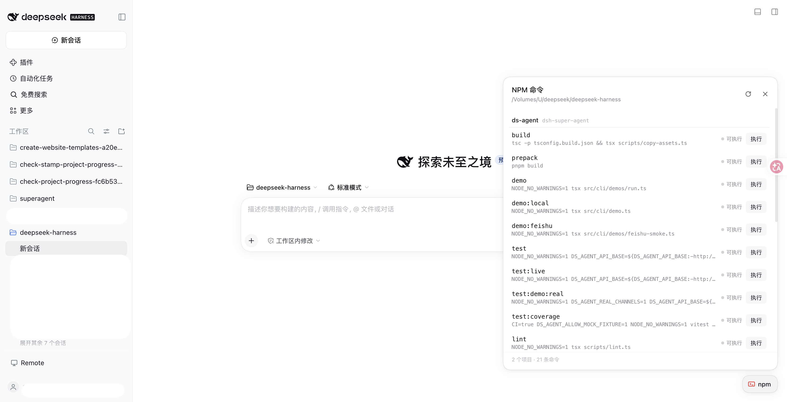
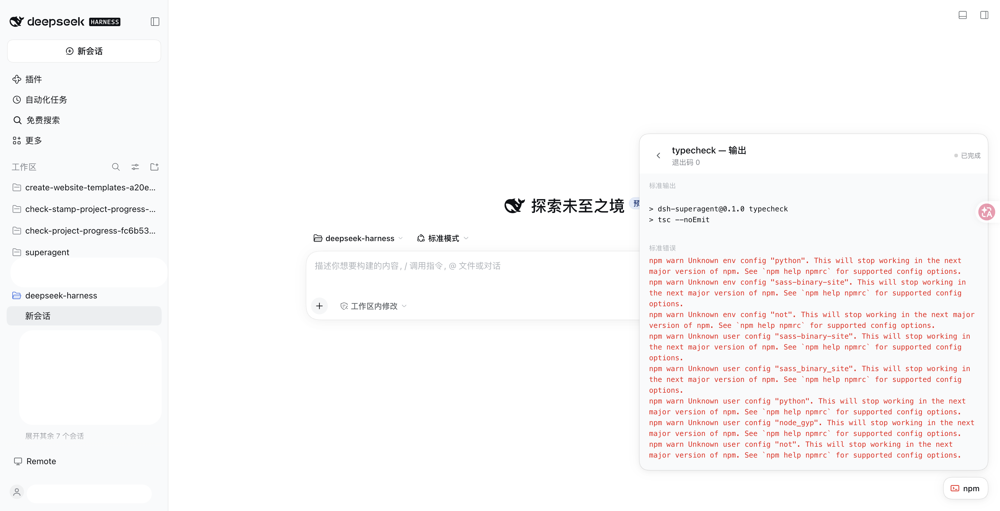

# dsh-npm-script

[](https://www.npmjs.com/package/@zouzhipeng/dsh-npm-script)
[](LICENSE)

**English** · [简体中文](#简体中文)

A floating button for the [DeepSeek Harness](https://github.com/deepseek-ai/deepseek-harness) Web UI. One click lists every npm script in your workspace, grouped by project, and lets you run them, stop the long-lived ones, and read their captured output. Any `http(s)` address printed by a script becomes a clickable link that opens in a new tab, so a dev server's debug URL is always one click away.



## Features

- **Floating launcher** — a small button pinned to the bottom-right corner; nothing is added to your panels.
- **Grouped by project** — scans the whole workspace, so a monorepo or several subprojects each get their own section of scripts.
- **Live status per command** — running / runnable / stopped is shown next to every script. Long-lived commands such as `npm run dev` keep a running state until you stop them.
- **Captured output** — stdout and stderr are collected while a script runs and stay readable after it exits.
- **Clickable URLs** — `http://` and `https://` addresses in the output are rendered as links (new tab) and collected into a shortcuts row above the log. Dev servers that print their debug address work out of the box.
- **Bilingual UI** — follows the Harness interface language (English / 简体中文).



## Install

Requires a running DeepSeek Harness. Either path works.

### Web UI

1. Open the Harness Web UI and go to **Plugins** in the sidebar.
2. Paste this spec into the install field:

   ```
   github:zouzhipeng/dsh-npm-script
   ```

3. Confirm, make sure the bundle is **enabled**, then refresh the page.

### CLI

```sh
dsh plugin --profile web add github:zouzhipeng/dsh-npm-script
```

The bundle is selected automatically. Refresh the Web UI afterwards.

The package is also published on [npm](https://www.npmjs.com/package/@zouzhipeng/dsh-npm-script) as `@zouzhipeng/dsh-npm-script`; publishing there only adds download statistics, installation still resolves from GitHub.

### Update

Re-run the install command to pull the latest version:

```sh
dsh plugin --profile web add github:zouzhipeng/dsh-npm-script
```

### Uninstall

Remove it from the Plugins page, or run:

```sh
dsh plugin --profile web remove @zouzhipeng/dsh-npm-script
```

## Usage

1. Click the floating button at the bottom-right to open the panel.
2. Scripts from every `package.json` are listed, grouped by project.
3. Click a command to run it; running commands show a stop button.
4. Open **Output** to read stdout and stderr. URLs in the output are clickable.

Press `Esc` to close the panel. While viewing output, the first `Esc` returns to the command list.

## Configuration

Optional settings can be overridden through `config` in the profile's `cordis.yml`:

| Field | Default | Meaning |
| --- | --- | --- |
| `scanDepth` | `3` | Maximum directory depth to scan for `package.json`. |
| `maxOutputBytes` | `262144` | Bytes of each output stream kept in memory (tail). |
| `maxSpillBytes` | `8388608` | Maximum bytes spilled to disk. |
| `graceMs` | `5000` | Grace period before force-terminating a stopped command. |
| `historyLimit` | `20` | Number of past runs retained. |
| `scanCacheMs` | `5000` | Cache lifetime for the project scan. |

## How it works

The plugin has two halves:

- **Host** (`index.js`) resolves the current workspace through Harness's `workspaceRegistry`, scans it for `package.json`, and launches scripts through the `subprocess` service. All HTTP routes are restricted to loopback.
- **Client** (`client.js`) renders the floating button and panel in the `shell.overlay` slot and talks to the Host over same-origin JSON routes.

Scripts are spawned with `NO_COLOR=1`, `TERM=dumb`, `PAGER=cat` and `GIT_PAGER=cat` so tools emit plain text and printed addresses stay intact. The client strips ANSI escapes as a fallback.

## Requirements

- DeepSeek Harness with the `web` profile.
- Any platform supported by Harness (macOS / Linux / Windows).
- Commands come only from the `scripts` field of `package.json`.

## Known limitations

- Only `http://` and `https://` addresses become links (`ws://` is excluded — a browser cannot open it directly).
- The command list comes from `package.json` scripts; arbitrary npm subcommands are not included.
- Host-side code changes need a `dsh web` restart (node-side hot reload is off by default); Client changes apply on refresh.

## License

[MIT](LICENSE)

---

## 简体中文

为 [DeepSeek Harness](https://github.com/deepseek-ai/deepseek-harness) Web 界面添加一个**悬浮按钮**：点击后按项目分组列出工作区里所有 `package.json` 脚本，可直接运行、停止常驻命令（如 `npm run dev`）、查看捕获的 stdout / stderr。输出里的 `http(s)` 地址会变成可点击链接并在新标签页打开，同时在日志上方汇总成一行快捷入口。

### 安装

Web 界面 **Plugins** 页填入 `github:zouzhipeng/dsh-npm-script`，或执行：

```sh
dsh plugin --profile web add github:zouzhipeng/dsh-npm-script
```

装完启用 bundle 并刷新页面。也可从 [npm](https://www.npmjs.com/package/@zouzhipeng/dsh-npm-script) 安装以显示下载量。

### 使用

点击右下角悬浮按钮打开面板；按项目分组列出脚本；点命令执行，执行中的命令显示停止按钮；点「输出」查看日志，日志里的网址可直接点击。按 `Esc` 关闭面板，查看输出时第一次 `Esc` 先返回列表。

### 配置

在 profile 的 `cordis.yml` 中通过 `config` 覆盖，可选项：`scanDepth`（3）、`maxOutputBytes`（262144）、`maxSpillBytes`（8388608）、`graceMs`（5000）、`historyLimit`（20）、`scanCacheMs`（5000）。

### 限制

- 仅 `http://` / `https://` 地址识别为链接，`ws://` 不识别。
- 命令只来自 `package.json` 的 `scripts`，不含任意 npm 子命令。
- Host 半代码改动需重启 `dsh web`，Client 半刷新页面即可。

### 许可

[MIT](LICENSE)
